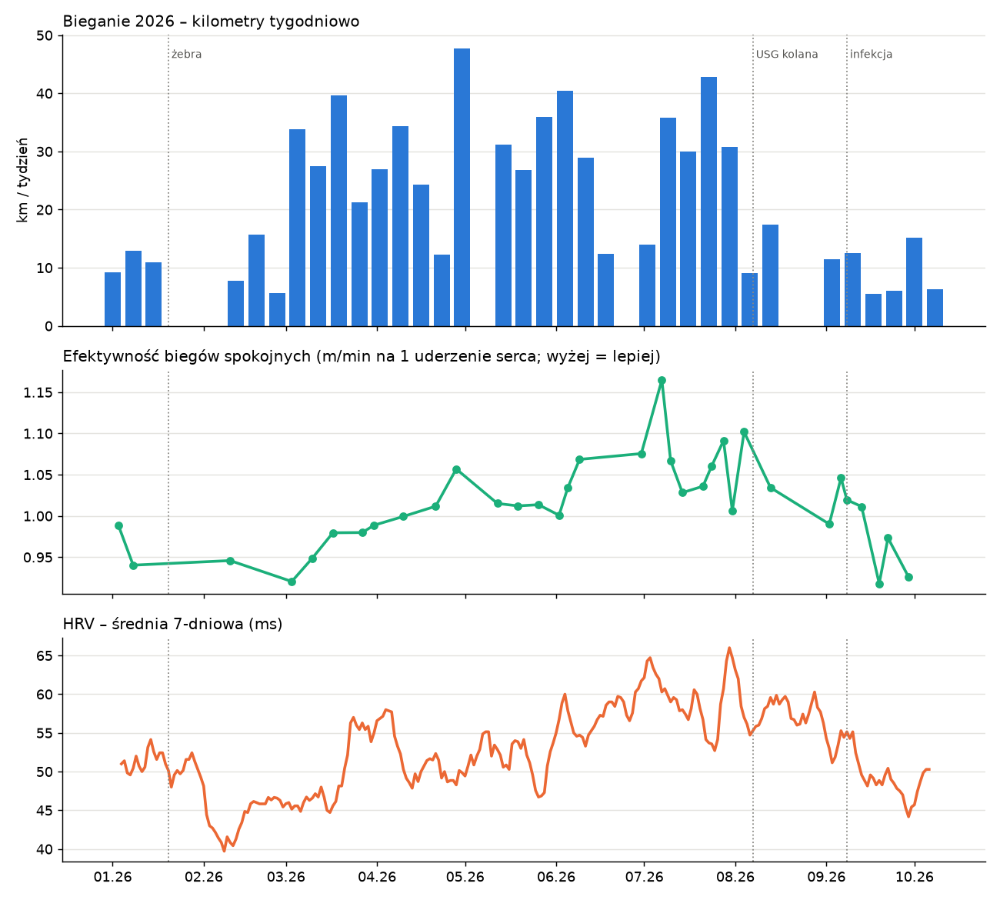

# Bieganie 2026 – podsumowanie i feedback

*Okres: 2026-01-01 → 2026-10-06. Źródła: `data/training/activities.csv`, `data/body/measurements.csv`, `data/body/sleep.csv`, `data/log/journal.md`, `profile/profile.md`. Wygenerowano 2026-10-06.*

## Liczby

- **90 biegów, 742.6 km, 78.4 h** (+ 44 jednostki siłowe, 12 rowerowe). Cały 2025: 140 biegów, 885.4 km.
- I–VII 2026: **649 km** vs I–VII 2025: 535 km (+21%). VIII–IX 2026: **78 km** vs VIII–IX 2025: 235 km.
- Tygodnie ≥30 km: 10 z 41; tygodnie bez biegu: 7; mediana tygodnia (z biegiem): 19.3 km. Maks.: 47.7 km (tydzień do 2026-05-03).

| Miesiąc | Biegi | km | h | Najdłuższy (km) | Śr. tętno |
|---|---|---|---|---|---|
| 2026-01 | 6 | 33.1 | 3.7 | 6.8 | 156 |
| 2026-02 | 6 | 29.2 | 3.4 | 5.7 | 159 |
| 2026-03 | 15 | 130.2 | 14.4 | 14.0 | 157 |
| 2026-04 | 11 | 109.8 | 11.5 | 17.0 | 156 |
| 2026-05 | 13 | 121.7 | 12.7 | 20.0 | 157 |
| 2026-06 | 11 | 87.8 | 8.9 | 15.0 | 153 |
| 2026-07 | 15 | 137.2 | 13.8 | 17.0 | 154 |
| 2026-08 | 4 | 36.4 | 3.7 | 10.0 | 152 |
| 2026-09 | 7 | 41.8 | 4.6 | 7.0 | 153 |
| 2026-10 (do 06.) | 2 | 15.3 | 1.7 | 9.0 | 157 |

Przerwy: 2026-01-16 → 02-09 (złamanie żeber VI–VIII), 05-04 → 05-11, 06-21 → 06-29, 08-15 → 09-01 (okres USG kolana 2026-08-07).

## Co idzie dobrze (fakty)

- **Rekord 5 km: 22:36 (4:29/km), 2026-06-20** (śr. HR 193, max 201). 2024-06-16: 26:42 → poprawa o ~4 min.
- **Efektywność aerobowa biegów spokojnych** (prędkość m/min ÷ śr. HR): Q1 0.961 (6:52/km @ 152) → Q2 1.029 (6:45 @ 144) → Q3 1.030 (6:31 @ 149); szczyt VII–VIII 1.06–1.10 (np. 2026-08-04: 9.06 km, 6:21/km @ 143).
- Struktura planu (Garmin, W1–W9): wtorek easy / środa jakość / piątek jakość lub easy / niedziela long – sensowna.
- Regeneracja w lipcu najlepsza w roku: tętno spoczynkowe śr. 46.7, HRV śr. 59.3 ms.

## Sygnały ostrzegawcze

1. **Skoki objętości tydzień do tygodnia:** 12.3 → 47.7 km (+287%, tydzień z 20 km longiem, 2026-05-03), po nim tydzień bez biegania; 13.9 → 35.8 km (+157%, 2026-07-12); 5.7 → 33.8 km (2026-03-08). Bezpiecznie: +10–20%/tydz.
2. **Za dużo jakości:** 33/90 biegów (37%) to interwały/tempo/progresje/RPE≥5; 11 tygodni z dwiema jednostkami jakościowymi (+ często progresywny long). Typowo 20–25%.
3. **Longi za mocno:** 2026-05-03 20 km @ HR 166 (6:29/km); 2026-07-18 15 km @ HR 164, TE 5.0; 2026-03-15 13 km @ HR 172. Dla porównania półmaraton 2025-09-06: śr. HR 181.
4. **Spadek formy od sierpnia:** efektywność we wrześniu 0.92–0.97 (2026-09-29: 7:03/km @ 153) – poziom z marca. VO2max Garmina 45 (2026-10-04/06) – najniżej w danych (VII 2026: 49.1; IX 2025: 50.7).
5. **Regeneracja obniżona, ale nie przez trening** (objętość niska): HRV 7-dn. ~47 ms (VII: 59), tętno spocz. 49–52 (VII: 46.7). Kontekst z dziennika: infekcja 2026-09-08→13, alkohol 2026-09-26/27 (sen 4.7 h, score 43), stres 8/10, część nocy 5.5–6.5 h.
6. **Kolano prawe:** USG 2026-08-07 – przeciążenie pasma biodrowo-piszczelowego; MR 2026-09-08 – dysplazja SRU, chondromalacja 2–2/3 st. *Hipoteza:* objawy po najmocniejszym okresie (VII: 137 km, 17 km long 2026-07-26 z 137 m przewyższenia). Siłownia w sezonie: 2–4 jednostki/mies. (V–VIII).

## Cel: półmaraton 1:45:00

- Wymagane tempo: **4:59/km**. Półmaraton 2025-09-06: **1:49:42** (5:10/km, śr. HR 181).
- 5 km 22:36 → wg wzoru Riegela ~**1:43:05** – ale to szczyt formy i zakłada wytrzymałość.
- Ocena: **dziś nierealne, realne po ≥12 tygodniach** regularnych 35–45 km/tydz. bez nawrotu kolana. Główny cel: **półmaraton we wrześniu 2027** (ustalone 2026-10-06). Plan: `reports/2026-10-plan-polmaraton-wrzesien-2027.md`.

## Rekomendacje

1. Najbliższe 3 tygodnie: tylko baza, ~20 → 23 → 26 km/tydz., HR ≤150. Pierwsza jakość łagodnie (np. 6–8×1 min / 2 min trucht), gdy HRV 7-dn. ≥50 ms i kolano ≤2/10 następnego dnia.
2. Maks. 1 jednostka jakościowa w tygodniu; long zawsze spokojnie (HR ≤150–155).
3. Siła 2×/tydz. przez cały rok (pośladkowe, czworogłowe, biodro); zakres ćwiczeń i zgoda na interwały – do ustalenia na wizycie z MR (lek. Gadziński) i z fizjoterapeutą.
4. Po biegach notować ból kolana 0–10 (`/dziennik`) i RPE w zegarku.

## Uwagi do danych

- 2026-06-10: śr. HR 131 przy max 181 – prawdopodobny błąd czujnika nadgarstkowego; pominięte przy wnioskach o tętnie.
- RPE z 2026-10-04 i 10-06 nie było w CSV – błąd `scripts/garmin_sync.py` (lista aktywności Garmina nie zawiera RPE); poprawione 2026-10-06, obie wartości uzupełnione (RPE 2).

## Pytania do lekarza / fizjoterapeuty

- Czy przy dysplazji SRU i chondromalacji 2–2/3 st. mogę wrócić do 35–45 km/tydz. i interwałów? Jakie są sygnały stop?
- Jakie ćwiczenia siłowe są bezpieczne dla rzepki (zakres zgięcia, obciążenie)?
- Czy możliwe „separujące się ciało chrzęstne” z MR zmienia zalecenia co do biegania?
