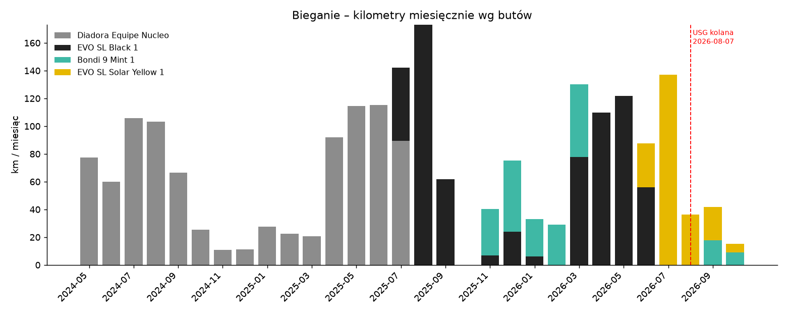

# Biegi a buty – analiza (2026-10-06)

Źródło: `data/training/activities.csv`, kolumna `gear` (431 biegów z przypisanymi butami, 2022-06 → 2026-10-06). Kategorie treningów wg tytułów Garmina (łatwy / długi / jakość / bieżnia / start); 89 biegów bez tytułu = „b.d.”. Wykres: `img/2026-10-buty-km.png`.

## Podsumowanie wg butów (fakty)

| But | Okres | Biegi | Km | Śr. km | Max km | Tempo śr. | HR śr. | Load śr. | RPE śr. |
|---|---|---|---|---|---|---|---|---|---|
| Kalenji JogFlow 500.1 | 2022-06 → 2024-05 | 108 | 511 | 4.8 | 10.4 | 7:31 | 153 | – | – |
| Diadora Equipe Nucleo | 2024-05 → 2025-07 | 180 | 943 | 5.2 | 20.1 | 6:43 | 153 | 88 | 3.4 |
| EVO SL Black 1 | 2025-07 → 2026-06-10 | 78 | 690 | 8.8 | 21.2 | 6:10 | 155 | 139 | 3.9 |
| Bondi 9 Mint 1 | 2025-11 → 2026-10-04 | 36 | 221 | 6.1 | 13.1 | 6:47 | 157 | 83 | 2.9 |
| EVO SL Solar Yellow 1 | 2026-06-12 → 2026-10-06 | 29 | 236 | 8.1 | 17.0 | 6:04 | 155 | 135 | 3.6 |

Role (liczba biegów: łatwe / długie / jakość / start):
- **Diadora** – wszystko, w tym 56 biegów na bieżni.
- **EVO SL Black** – but „do wszystkiego, co ważne”: 15 długich, 31 jakościowych, półmaraton 2025-09-06 (21.23 km, 1:49:42, 5:10/km, HR 181) i test 5 km 2026-04-22.
- **Bondi 9** – łatwe i regeneracyjne (18 łatwych, 3 długie do 13 km, 3 jakościowe); używane zimą 2025/26 i od 2026-09-19.
- **EVO SL Yellow** – następca Black: 5 długich (do 17 km), 8 jakościowych.

## Porównanie w tym samym okresie (łatwe biegi)

| Okres | But | n | Tempo (mediana) | HR (mediana) | m/min na uderzenie |
|---|---|---|---|---|---|
| 2025-11 → 2026-06, łatwe, HR 145–160 | Bondi 9 | 16 | 6:49 | 155 | 0.94 |
| | EVO SL Black | 6 | 6:44 | 147 | 1.01 |
| 2026-09-02 → 2026-10-06, wszystkie (RPE 2–3) | Bondi 9 | 4 | 6:52 | 155 | 0.93 |
| | EVO SL Yellow | 5 | 6:29 | 152 | 1.01 |

W Bondi biegasz łatwe biegi ~20–25 s/km wolniej przy podobnym lub wyższym tętnie (efektywność ~8% niższa).

## Kolano a buty (fakty + interpretacja)

- Tygodniowy kilometraż: maj–czerwiec 27–48 km/tydz. w EVO Black bez wpisów o dolegliwościach.
- Przejście na EVO Yellow 2026-06-12, potem dołek (12.4 km, 0 km, 13.9 km w tygodniach do 2026-07-05) i szybki powrót: **13.9 → 35.8 → 30.0 → 42.8 → 30.8 km/tydz.** (lipiec 137 km – najwięcej od 2025-08).
- 2026-08-07 USG: przeciążenie pasma biodrowo-piszczelowego; potem spadek do 9–17 km/tydz.
- **Interpretacja:** zbieżność w czasie nowego buta i skoku objętości o ~150% tydzień do tygodnia. Z danych nie da się oddzielić wpływu buta od skoku obciążenia – ta sama objętość w tym samym modelu (EVO Black) w kwietniu–maju była tolerowana, więc skok objętości jest bardziej prawdopodobnym czynnikiem niż sam but (hipoteza).

## Zastrzeżenia

- Różnice między butami są pomieszane z porą roku (Bondi głównie zima i okres po kontuzji), formą (Kalenji = początek biegania) i rodzajem treningu – stąd porównania tylko w tych samych okresach.
- Małe próby (4–16 biegów w porównaniach).
- 1 bieg bez butów (2023-01-28). Km liczone z CSV, bez kilometrów startowych w Garminie.

## Następne kroki

1. EVO SL Black (690 km, limit 644) – oznacz w Garminie jako wycofane albo zostaw tylko na spacery.
2. Przy powrocie do biegów jakościowych (od 2026-10-05) – trzymaj progresję ≤10–20% tydzień do tygodnia, niezależnie od butów.
3. Zapisuj w dzienniku ból kolana po biegach (0–10) – po kilku tygodniach da się porównać Bondi vs EVO SL na Twoich danych.
4. Pytanie do fizjoterapeuty / lekarza od kolana: czy przy dysplazji SRU i przeciążeniu ITB preferować but z większą amortyzacją (Bondi) na łatwe biegi, a lżejszy (EVO SL) tylko na jakość.
